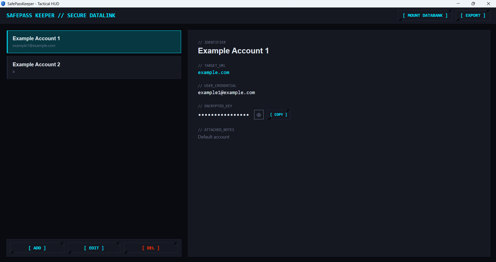
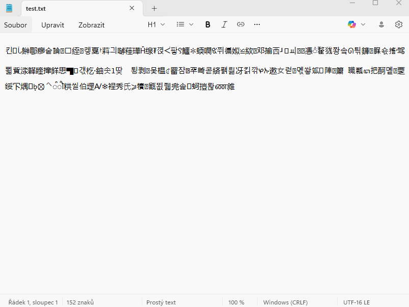

# 🛡️ SafePassKeeper

SafePassKeeper is a locally hosted, highly secure password manager featuring a **custom tactical HUD interface**. It is designed to securely store your credentials using strong AES encryption while providing an immersive, terminal-like user experience.

## ✨ Features

- **Military-Grade AES Encryption:** Your vault is secured using advanced AES encryption. The master key is never saved and is required every time you mount a databank.
- **Tactical HUD Interface:** A completely custom-styled WPF interface featuring chamfered edges, neon glows, and a dark-matter color palette.
- **Zero-Cloud Local Storage:** Your passwords never leave your machine. Data is stored in a heavily encrypted local `.txt` file of your choosing.
- **Secure Reveal & Copy:**
  - Passwords are obfuscated by default.
  - Visual glitch-effect on reveal to prevent shoulder-surfing.
  - 1-Click secure clipboard copy (`[ COPY ]` feature).

## 🛠️ Tech Stack

- **Language:** C#
- **Framework:** .NET / WPF (Windows Presentation Foundation)
- **Architecture:** Custom ControlTemplates, DataBinding, XAML Triggers
- **Data Format:** Encrypted JSON

## 🚀 How to Use

1. **Mount Databank:** Click `[ MOUNT DATABANK ]` and select an existing `.txt` file or create a new empty text file to initialize a new databank.
2. **Security Override:** Enter your master password. If it's a new file, this password will become your permanent encryption key.
3. **Manage Data:** Add, edit, or delete credentials using the terminal controls.
4. **Export Backup:** You can securely export your vault data if needed.

> ⚠️ **IMPORTANT:** There is no "forgot password" feature. If you lose your master key, your databank cannot be recovered.

## 📸 Interface Preview

